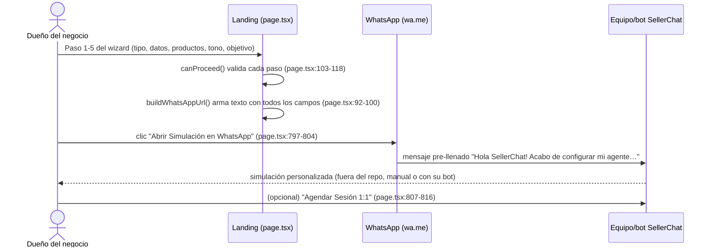
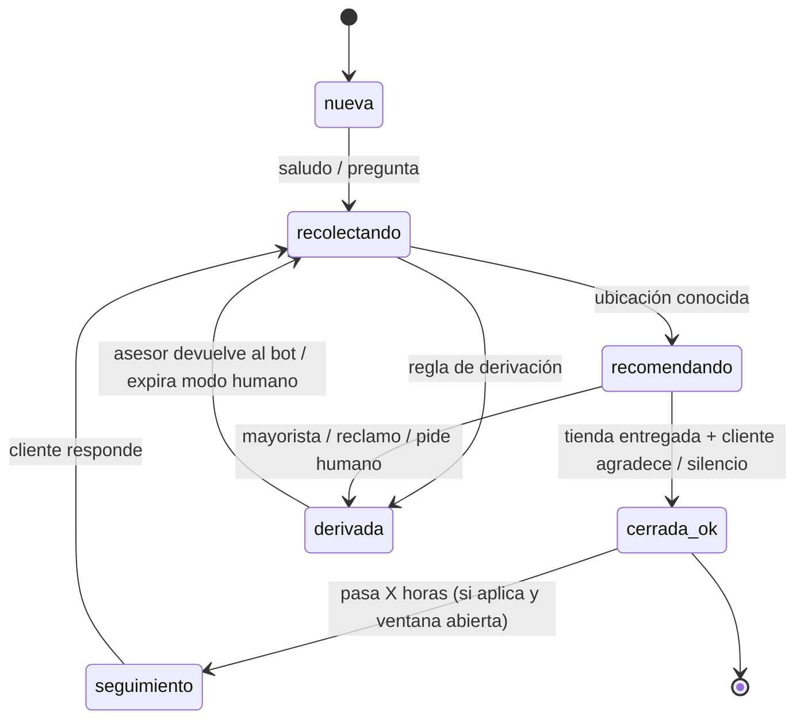

# 02 · Flujo de un mensaje

> Agente 1 · 2026-10-14. Alias de repos: ver `01-mapa-del-codigo.md`.
> Los repos de referencia **no** tienen un flujo de mensajes de chat (no contienen el motor de SellerChat).
> Aquí documentamos (A) los dos flujos que sí existen en el código y (B) el flujo **propuesto** para nuestro framework,
> que reúne lo aprendido + las reglas de Meta (`07`).

## A1. [PA] Landing → WhatsApp (captación del negocio, no del cliente final)



Observación: **el estado nunca sale del navegador** salvo dentro del texto del enlace; no hay API ni base de datos.
La "configuración" del agente la hace después una persona de SellerChat a partir de ese mensaje.

## A2. [SB] Llamada entrante (SellerCall, voz)

```mermaid
sequenceDiagram
    actor C as Cliente
    participant T as Twilio
    participant API as InboundController
    participant U as Ultravox
    participant DB as MySQL
    participant P as Panel (SignalR)
    C->>T: llama al número
    T->>API: POST /api/inbound (form con CallSid, From, To) — InboundController.cs:37-45
    API->>U: POST /api/calls {systemPrompt, voice, maxDuration 300s, medium sip} — UltravoxService.cs:67-109
    U-->>API: callId + joinUrl
    API->>DB: CallMappings(callId↔CallSid) + CallHistory(isActive=true) — InboundController.cs:52-74
    API->>P: ReceiveCallInfo — InboundController.cs:76-82
    API->>DB: programa re-llamada si el usuario tiene AutoTrigger — InboundController.cs:84-89
    API-->>T: TwiML <Dial action=/api/llamada/ended><Sip>joinUrl</Sip></Dial> — InboundController.cs:96-103
    T->>U: conecta audio por SIP; la IA conversa
    T->>API: POST /api/llamada/ended (CallSid) — LlamadaController.cs:175-222
    API->>U: GET /api/calls/{id} (reintenta 5×3 s hasta tener summary) — UltravoxService.cs:110-159
    API->>DB: guarda summary, shortSummary, endedAt, isActive=false
    API->>P: ReceiveCallStatus / ReceiveCallInfo
```

Patrones útiles que extraemos:
1. **Responder rápido al webhook** y delegar la conversación a otro servicio (Twilio exige respuesta inmediata; Meta también, ver B).
2. **Mapa id-externo ↔ id-interno** persistido (`CallMappingEntry`, [SB] `Models/CallMappingEntry.cs:5-11`) — nosotros: `wamid`/`update_id` ↔ mensaje.
3. **Post-procesado al cerrar**: resumen corto/largo de la interacción ([SB] `LlamadaController.cs:205-214`).
4. Lo que **no** copiamos: reintentos bloqueantes con `Task.Delay` dentro del request ([SB] `UltravoxService.cs:119-155`), y el diccionario estático en memoria
   `CallMapping` que se pierde al reiniciar ([SB] `Controllers/CallMapping.cs:6-7`).

---

## B. Flujo propuesto para nuestro framework (chat: web, Telegram, luego WhatsApp/Instagram)

```mermaid
flowchart TD
    A[Webhook / long-polling<br/>web · telegram · whatsapp · instagram] --> B{verifyWebhook<br/>firma X-Hub-Signature-256 / secret_token}
    B -- inválida --> X[403 y log]
    B -- ok --> C[ACK 200 inmediato<br/>Meta reintenta si tarda]
    C --> D[ChannelAdapter.parseWebhook → IncomingMessage[]]
    D --> E{¿id externo ya visto?<br/>idempotencia}
    E -- sí --> Z[descartar duplicado]
    E -- no --> F[Cola por usuario<br/>serializa y agrupa ráfagas 2-4 s]
    F --> G[Pre-procesado de medios<br/>audio→texto · imagen→descripción · ubicación→lat/lng]
    G --> H[Store.getConversation<br/>estado + campos recolectados + modo bot/humano]
    H --> I{¿modo humano activo?}
    I -- sí --> J[reenviar a bandeja humana y NO responder]
    I -- no --> K[Reglas deterministas<br/>reglas_derivacion · palabras clave · horario]
    K -- deriva --> L[Handoff: saveHandoff + aviso al cliente + notificar asesor]
    K -- sigue --> M[Armar contexto<br/>prompt sistema + conocimiento relevante + estado del flujo + últimos N turnos]
    M --> N[LLMProvider.complete con tools<br/>buscar_tienda · buscar_producto · derivar_humano · guardar_dato]
    N --> O{toolCalls?}
    O -- sí --> P[Ejecutar tool<br/>StoreLocator.find, catálogo, etc.] --> N
    O -- no --> Q[Guardas de salida<br/>sin precios · tiendas solo del CSV · longitud · tono]
    Q -- falla --> R[regenerar 1 vez o respuesta segura] --> S
    Q -- ok --> S[Partir en burbujas ≤ 2-3 y formatear por canal<br/>botones / lista / ubicación]
    S --> T{¿ventana 24 h abierta?<br/>solo WA/IG}
    T -- no --> U[solo plantilla aprobada]
    T -- sí --> V[ChannelAdapter.send]
    U --> V
    V --> W[Store.saveConversation<br/>+ métricas + programar seguimiento si aplica]
```

### Detalle por etapa (qué debe hacer el Agente 2)

| # | Etapa | Por qué | Referencia |
|---|---|---|---|
| 1 | **Verificar firma** del webhook (`X-Hub-Signature-256` con App Secret en Meta; `X-Telegram-Bot-Api-Secret-Token` en Telegram) | Evitar mensajes falsos; [SB] no autentica nada (`01`, problema 7) | `07` |
| 2 | **ACK 200 inmediato**, procesar en segundo plano | Meta reintenta webhooks no confirmados y genera duplicados | `07` |
| 3 | **Idempotencia** por id externo (`messages[].id` de WhatsApp, `message.mid` de Instagram, `update_id` de Telegram) | Reintentos de Meta/Telegram | patrón de [SB] `CallMappingEntry` |
| 4 | **Debounce / agrupación**: esperar 2–4 s y unir mensajes seguidos del mismo usuario ("hola" · "una pregunta" · "tienen posca?") | Los clientes escriben en ráfagas; responder a cada fragmento suena a robot y gasta tokens | práctica común en bots de venta (SellerChat lo anuncia como "parece humano", `07`) |
| 5 | **Medios**: audio → transcripción; imagen → descripción (¿es una foto de un POSCA?); ubicación compartida → `location` | SellerChat entiende notas de voz e imágenes (`07`); `IncomingMessage.location` ya está en el contrato | `docs/CONTRATO.md` §3 |
| 6 | **Modo humano** por conversación (`bot` / `humano` / `pausado`) con expiración (p. ej. 12 h) | Si un asesor tomó el chat, el bot **no** debe interrumpir | `04` |
| 7 | **Reglas deterministas antes del LLM** (pedir humano, reclamo, mayorista, fuera de horario) | Más baratas, predecibles y testeables | `bot.yaml → reglas_derivacion` |
| 8 | **Contexto mínimo**: prompt + solo fragmentos relevantes de `conocimiento/` + estado del flujo + últimos ~10 turnos + resumen de lo anterior | Coste y menos alucinación | `03` |
| 9 | **Tools** en vez de pegar todo el CSV en el prompt: `buscar_tienda(ciudad|lat,lng, producto?)`, `buscar_producto(texto)`, `derivar_humano(motivo)`, `guardar_dato(campo, valor)` | El LLM no puede inventar tiendas si solo puede citarlas desde la tool | `03` |
| 10 | **Guardas de salida** (regex + verificación): sin `$`/precios si `limites.nunca` lo prohíbe; cada nombre de tienda en la respuesta debe existir en `tiendas.csv`; teléfonos solo los del CSV | Riesgo principal: alucinar tiendas/precios | `00-RESUMEN.md` riesgos |
| 11 | **Formato por canal**: WhatsApp admite botones (máx. 3) y listas (máx. 10 filas); Telegram teclado inline; web HTML simple | Botones reducen errores de escritura | `05` |
| 12 | **Ventana de 24 h** (WhatsApp/Instagram): fuera de ella solo plantillas (WA) o nada (IG, salvo etiqueta humana 7 días) | Política de Meta | `07` |
| 13 | **Persistir y programar** seguimiento; generar `resumen_corto` al cerrar | Idea de [SB] | `04` |

### Latencia objetivo
- ACK del webhook: < 1 s.
- Primera respuesta visible: 3–8 s (incluye debounce). Mostrar "escribiendo…" (`sendChatAction typing` en Telegram;
  en WhatsApp Cloud API existe indicador de escritura al marcar como leído).
- Un solo viaje al LLM en el caso típico; máx. 3 iteraciones de tools.

### Estados de una conversación (propuesta)


